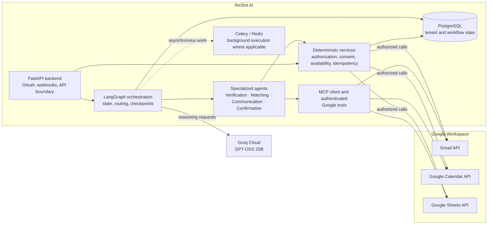
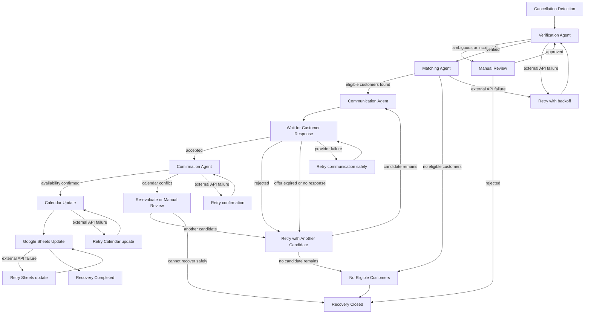
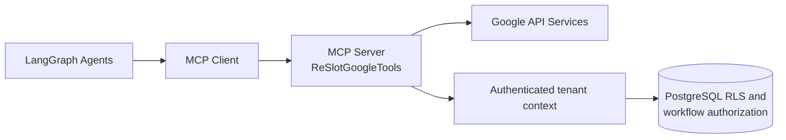

# ReSlot AI

ReSlot AI is an intelligent, multi-agent reservation recovery system designed to help reservation-based businesses recover last-minute cancellations. It works with the systems a business already uses—Gmail, Google Calendar and Google Sheets—instead of replacing its reservation-management software.

The system is designed for restaurants, hotels, beauty salons, consulting services, coworking spaces and similar businesses. Specialized agents verify cancelled reservations, identify suitable replacement customers, communicate available opportunities and coordinate a safe confirmation.

## Overview

A cancellation creates a short-lived opportunity. ReSlot AI turns that opportunity into a controlled recovery workflow:

1. Cancellation signals are detected from Gmail and Google Calendar.
2. Reservation details are normalized and verified against the authorized calendar.
3. Waiting-list records in Google Sheets are filtered using deterministic eligibility rules.
4. Candidate preferences are evaluated and eligible customers are ranked for outreach.
5. A consent-aware, personalized offer is communicated through Gmail.
6. Rejections, timeouts and expirations advance the workflow to the next candidate.
7. Acceptance is rechecked against current availability before any booking change.
8. Calendar and waiting-list records are synchronized with idempotent, tenant-scoped operations.

AI is used for interpretation, language generation and decision support. Authorization, consent, eligibility constraints, availability checks and irreversible external actions remain enforced by deterministic application services.

## Key Features

- Automatic cancellation detection from Gmail messages and Google Calendar events.
- Reservation verification using normalized Calendar data and explicit review reasons.
- Waiting-list matching backed by Google Sheets customer and preference records.
- Preference-aware candidate ranking with deterministic eligibility constraints and review flags.
- Personalized multilingual communications generated from verified reservation context.
- Candidate progression after rejection, non-response or offer expiration.
- Acceptance handling with a final availability check before confirmation.
- Google Calendar synchronization for the recovered reservation.
- Google Sheets updates for waiting-list status and workflow outcomes.
- Concurrent recovery workflows with tenant-scoped locks, idempotency records and durable state.
- Human-in-the-loop interrupts for ambiguous cancellations, sensitive preferences and conflicts.
- Failure recovery for checkpointed workflows and transient external API errors.
- Secure multi-tenant execution with separate Google connections and authorization contexts per business.

## System Architecture

ReSlot AI has a deliberately small application boundary. FastAPI handles authentication, OAuth, webhooks and operational endpoints. LangGraph coordinates durable agent workflows. MCP provides a controlled tool boundary to Google services, while PostgreSQL stores tenant metadata, workflow state, idempotency receipts and minimal integration snapshots.



The agents do not receive arbitrary credentials, tenant identifiers or provider resource IDs from model-generated arguments. A trusted server-side execution context resolves the current business, checks membership and permissions, and authorizes each tool call before it reaches a Google API.

## Multi-Agent Workflow

The intended workflow is a durable LangGraph state machine. Each recovery has a correlation ID and checkpointed state containing only the data needed to resume safely: tenant context, reservation identity, candidate progress, communication state, deadlines, review decisions and external operation receipts.



LangGraph supplies the orchestration model for conditional routing, checkpointing, interrupts and workflow resumption. A manual-review interrupt pauses the graph without losing context. A worker can resume from the last durable checkpoint after a process restart or transient provider failure. External operations use idempotency keys and verification reads so retries do not blindly repeat a booking or status change. Availability is checked immediately before confirmation; an earlier read is an observation, not a hold.

## Specialized AI Agents

All four agents can use GPT-OSS 20B through Groq Cloud for bounded reasoning and language tasks. The model receives normalized, tenant-authorized context and returns structured decisions that are validated before the graph proceeds. Deterministic services remain authoritative for permissions, consent, time windows, capacity, calendar conflicts and writes.

### Verification Agent

The Verification Agent interprets a cancellation signal from Gmail or Calendar, resolves the corresponding event and retrieves the selected calendar record. It validates the reservation time, party size, offering and business context, distinguishes a true cancellation from an ambiguous or stale signal, and produces a structured verification result. Missing or contradictory information routes to human review rather than being guessed by the model.

### Matching Agent

The Matching Agent requests authorized waiting-list data and customer profiles, then identifies eligible replacement candidates. Deterministic filters enforce consent, status, offering, time window, capacity and other hard constraints. GPT-OSS 20B may interpret non-structured preferences or help rank otherwise eligible candidates, but it cannot override an eligibility failure. Sensitive or ambiguous preferences are marked for review.

### Communication Agent

The Communication Agent creates a concise, personalized offer using verified reservation details and the customer's communication preferences. It supports multilingual message generation and interprets replies such as acceptance, rejection or uncertainty. Outbound communication requires explicit consent, and untrusted email content is treated as data rather than instructions. Offer deadlines and candidate state are stored so a rejection or expiration can advance the workflow without duplicating an offer.

### Confirmation Agent

The Confirmation Agent verifies that the customer accepted the specific offer and that the reservation is still available. It requests a fresh Calendar availability check and validates all confirmation constraints. Only after deterministic checks pass can the application initiate a Calendar update and synchronize the waiting-list state. A conflict or uncertain acceptance routes to another candidate or manual review.

## MCP Tool Integration

The Model Context Protocol (MCP) provides a standardized, typed boundary between agent workflows and external Google services. It separates reasoning from tool execution, makes tool contracts discoverable, and gives the application a single place to validate inputs, authorize access and sanitize outputs.



The repository's authenticated MCP server exposes these tool names:

| Tool | Responsibility |
| --- | --- |
| `get_calendar_event` | Read and normalize a selected-calendar event, including review reasons. |
| `check_calendar_availability` | Check overlap for an authorized time window and optional resource label. |
| `get_waitlist_candidates` | Apply deterministic status, consent, offering, time and capacity filters. |
| `get_customer_profile` | Read the minimal authorized customer profile and notification consent. |
| `get_waitlist_entry` | Read a validated waiting-list entry and its preferences. |
| `get_email_message` | Read bounded, untrusted Gmail message content and metadata. |

Tool arguments deliberately omit tenant, calendar, spreadsheet, connection and database identifiers. A trusted `SessionExecutor` pins the business and creates a fresh authorization and database context for each call. Membership, role, session validity, selected Google connection and PostgreSQL row-level security are checked before the provider request. Fixed result categories such as `OK`, `NOT_FOUND`, `INVALID_INPUT`, `ACCESS_DENIED`, `GOOGLE_API_ERROR` and `REVIEW_REQUIRED` allow the graph to route failures without exposing credentials or raw provider exceptions.

The current MCP implementation is local and authenticated; a workflow should use a separate server instance and immutable execution context per recovery. MCP is an integration boundary, not a way to expose arbitrary Google APIs or a shared mutable tenant variable to an LLM.

## Google Workspace Integrations

### Gmail

Gmail supplies cancellation messages, customer replies and outbound offer delivery. Message reads are bounded and classified as untrusted input. The communication path uses customer consent and tenant-scoped credentials; message content cannot authorize a tool call or change workflow policy.

### Google Calendar

Calendar is the authoritative source for reservation events and current availability. ReSlot AI normalizes event metadata, detects cancellation signals and checks conflicts before confirmation. Calendar updates are performed only after acceptance and a fresh deterministic availability check, with idempotency and verification reads around external writes.

### Google Sheets

An authorized business spreadsheet stores the customer and waiting-list records used by matching. Stable IDs, status, consent, requested offering, preferred intervals and capacity requirements are validated before use. Waiting-list updates are scoped to the current tenant and verified after a write; concurrent structural edits in Sheets remain an external consistency boundary and can require review.

## Technology Stack

| Technology | Architectural responsibility |
| --- | --- |
| Python | Core backend language for services, workflows, integrations and tooling. |
| LangGraph | Durable multi-agent graph execution, conditional routing, interrupts and resumption. |
| GPT-OSS 20B | Reasoning and language model for bounded interpretation, ranking support and message generation. |
| Groq Cloud | LLM inference provider configured through `GROQ_API_KEY` and `GROQ_MODEL`. |
| MCP | Typed, standardized communication between agents and controlled external tools. |
| FastAPI | Minimal HTTP boundary for authentication, OAuth callbacks, webhooks, health checks and APIs. |
| Gmail API | Cancellation/reply message reads and consent-aware offer communication. |
| Google Calendar API | Reservation lookup, cancellation verification, availability checks and synchronization. |
| Google Sheets API | Customer profiles, waiting-list candidates, preferences and status synchronization. |
| PostgreSQL | Tenant-scoped persistence, workflow checkpoints, idempotency and concurrency controls. |
| SQLAlchemy | Database sessions, models, repositories and transaction boundaries. |
| Alembic | Versioned schema migrations and migration consistency checks. |
| Celery / Redis | Optional background task execution and queue infrastructure where asynchronous work is enabled. |
| Docker | Reproducible local application environment for the API, frontend, PostgreSQL and Redis. |
| Pytest | Backend unit and integration test execution, including security and MCP contracts. |

## Multi-Tenancy and Security

- **Separate Google connections:** Each business authorizes its own Google account, calendar and spreadsheet. Credentials are encrypted server-side and never sent to browser code or model prompts.
- **Tenant-scoped authorization:** A server-side session pins the active business. Repository predicates, PostgreSQL row-level security and transaction-local context provide defense in depth.
- **Tool isolation:** MCP tools do not accept tenant or provider resource identifiers from agents. Authorization is rechecked on every call, and a workflow must create a new context after a tenant switch.
- **Data minimization:** Calendar snapshots and tool responses contain only the fields required for the workflow. Contact data, message bodies and credentials are not copied into prompts unless needed for the authorized operation.
- **Consent-based communication:** Waiting-list status and explicit notification consent are hard eligibility requirements before an offer is sent.
- **Prompt-injection protection:** Gmail text and free-form customer preferences are untrusted data. They are bounded, labeled and never treated as instructions that can change authorization or invoke tools.
- **Concurrency and idempotency:** Tenant-scoped locks, workflow correlation IDs, checkpointing and external-operation receipts make retries explicit and prevent duplicate actions where the provider supports verification.
- **AI and critical-operation separation:** Models propose interpretations and content. Deterministic services enforce authorization, consent, hard eligibility rules, availability and irreversible Calendar or Sheets operations.
- **Human oversight:** Ambiguous cancellations, sensitive preferences, conflicts and provider consistency concerns can interrupt the graph for an authorized reviewer.

## Example Recovery Workflow

The following is an illustrative scenario describing the intended coordination; it is not a fabricated execution result.

1. A restaurant's reservation for four people is cancelled shortly before the booking time.
2. The Verification Agent reads the cancellation signal, retrieves the Calendar event and confirms the cancelled time, offering and party size.
3. The Matching Agent queries the restaurant's authorized Google Sheets waiting list.
4. Three customers meet the deterministic offering, interval, capacity, status and consent rules.
5. The Communication Agent generates a personalized offer for the highest-ranked candidate and sends it through the authorized Gmail connection with a clear response deadline.
6. The first candidate declines. The response is recorded and the graph follows its rejection branch.
7. The workflow resumes at candidate progression and automatically prepares an offer for the second candidate.
8. The second candidate accepts the specific offer.
9. The Confirmation Agent verifies the acceptance, performs a fresh Calendar availability check and confirms that no conflicting booking has appeared.
10. The application updates Google Calendar and synchronizes the waiting-list status in Google Sheets, using idempotency and verification reads around each external operation.

If the Calendar check finds a conflict, the workflow does not force the booking. It can try the next eligible candidate or interrupt for review according to the business policy.

## Project Structure

```text
.
├── backend/
│   ├── app/
│   │   ├── api/              FastAPI routes and request dependencies
│   │   ├── core/             Configuration, security, context and Celery setup
│   │   ├── db/               SQLAlchemy sessions and migration helpers
│   │   ├── integrations/     Google transport and provider configuration
│   │   ├── mcp/              Authenticated MCP server, client, schemas and tools
│   │   ├── models/           Tenant, identity, Google and automation persistence
│   │   ├── repositories/     Tenant-scoped database access
│   │   └── services/         Google and domain services
│   ├── migrations/           Alembic environment and migration versions
│   ├── scripts/              Backend verification and MCP demonstration utilities
│   ├── tests/                Backend unit, security, integration and MCP tests
│   └── pyproject.toml        Python dependencies and tool configuration
├── frontend/                 React/Vite integration and settings interface
├── docs/                     Architecture, Google setup, security and MCP references
├── compose.yaml              Local Docker Compose services
├── .env.example              Local configuration template
└── legacy/                   Retained historical reservation-management source
```

The active application is an integration and orchestration boundary, not a replacement reservation-management platform with a broad CRUD domain.

## Installation and Configuration

### Docker Compose

Requirements: Docker Desktop with the Linux engine and Compose v2.

From the repository root in PowerShell:

```powershell
Copy-Item .env.example .env
```

Set unique values in `.env` for `POSTGRES_PASSWORD`, `APP_DATABASE_PASSWORD` and `GOOGLE_TOKEN_ENCRYPTION_KEY`. Configure the Google OAuth client, redirect URI, `GROQ_API_KEY` and `GROQ_MODEL` when those integrations are used. Keep `.env`, OAuth secrets and downloaded credentials out of version control.

The Compose environment defines PostgreSQL, Redis, the migration container, FastAPI, the optional Celery worker and the frontend. Google OAuth setup and spreadsheet/calendar conventions are documented in [Google setup](docs/google-setup.md), [Google security](docs/google-security.md), [Google Sheets](docs/google-sheets.md) and [Calendar reservation format](docs/calendar-reservation-format.md).

### Local backend and frontend

For local development, use Python 3.12 or newer and Node 24 or newer, with PostgreSQL and Redis available. Install the backend package and development tools from the repository root:

```powershell
python -m venv .venv
.\.venv\Scripts\python -m pip install -e "./backend[dev]"
docker compose up -d postgres redis
```

The backend reads the root `.env` file. Use the configured database URLs and Google OAuth settings for the environment you are connecting to.

## Running ReSlot AI

Start the complete local Compose environment:

```powershell
docker compose up --build -d
docker compose ps -a
Invoke-RestMethod http://localhost:8000/health/ready
Start-Process http://localhost:5173
```

The FastAPI service exposes API documentation at `http://localhost:8000/docs`; the frontend is served at `http://localhost:5173`.

To run the backend directly after starting PostgreSQL and Redis:

```powershell
Set-Location backend
..\.venv\Scripts\python -m app.db.migrate
..\.venv\Scripts\uvicorn app.main:app --reload
```

In a second terminal, run the Vite frontend:

```powershell
Set-Location frontend
npm ci
npm run dev
```

The repository also includes an offline MCP demonstration using synthetic data. From the root:

```powershell
Push-Location backend
..\.venv\Scripts\python scripts/mcp_demo.py
Pop-Location
```

For authenticated Google-account testing and the available arguments, see [MCP integration](docs/mcp.md).

## Testing

Install the backend development dependencies as described above. The default backend test suite can run without PostgreSQL; tests marked `integration` require the test database URLs described in the repository's test configuration.

From the repository root:

```powershell
Set-Location backend
..\.venv\Scripts\ruff check .
..\.venv\Scripts\ruff format --check .
..\.venv\Scripts\mypy app
..\.venv\Scripts\python scripts/test_backend.py
..\.venv\Scripts\python scripts/test_backend.py --database
```

Run the frontend checks from `frontend/`:

```powershell
npm run lint
npm run typecheck
npm run build
```

The database helper provisions a disposable database when the required test URLs are configured, replays Alembic migrations and runs the backend tests. For integration-specific setup and Google smoke-test guidance, see [integration smoke testing](docs/integration-smoke-test.md) and [verification notes](docs/verification.md).
