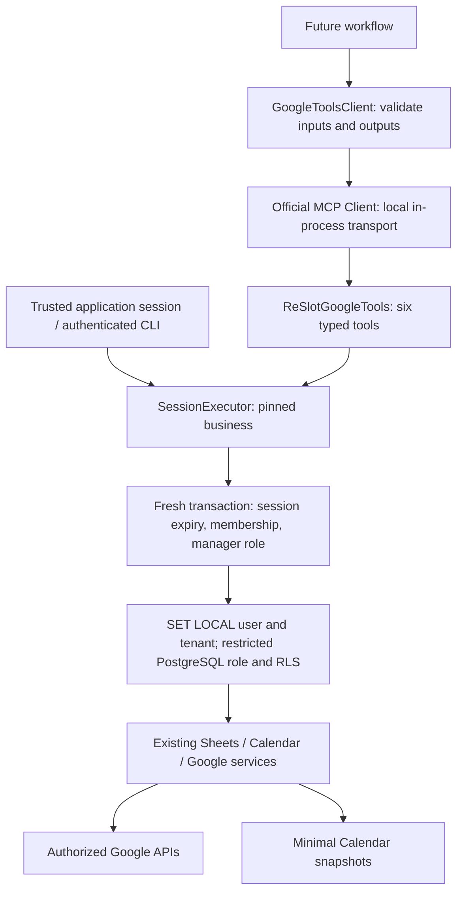

# ReSlotGoogleTools (Task 05)

The official Python MCP SDK is pinned to stable `mcp==2.2.0`, using `MCPServer` and
`Client(server)`. References: [SDK releases](https://github.com/modelcontextprotocol/python-sdk/releases)
and [official client documentation](https://py.sdk.modelcontextprotocol.io/client/).
No LangGraph agent, LLM invocation, monitoring, booking CRUD or outbound communication is added.



## Startup and demonstration

From the repository root in PowerShell:

```powershell
.\.venv\Scripts\python -m pip install -e "./backend[dev]"
Push-Location backend
..\.venv\Scripts\python scripts/mcp_demo.py
Pop-Location
```

The default demonstration starts an in-process MCP server, connects the official client, lists
six tools, and reads a synthetic event, filtered candidates and a synthetic customer. It needs
neither Google credentials nor PostgreSQL. Its mocked service fixtures live only in the demo
script and cannot be enabled through any application endpoint or MCP argument. It prints
synthetic structured data. Production server creation requires a verified application session.

For the application and real-account demonstration:

```powershell
docker compose up --build -d
Invoke-RestMethod http://localhost:8000/health/ready
Push-Location backend
..\.venv\Scripts\python scripts/mcp_demo.py --real --base-url http://localhost:5173 --email owner@example.com --tenant-id YOUR_BUSINESS_UUID --event-id YOUR_EVENT_ID --customer-id YOUR_CUSTOMER_ID --offering "Dinner" --start-at "2027-01-02T17:00:00Z" --end-at "2027-01-02T18:00:00Z" --party-size 2 --quantity 1
Pop-Location
```

Use a **dedicated Google test account and synthetic source records**. Follow
[Google setup](google-setup.md), reauthorize for Sheets, configure a spreadsheet, select a writable
calendar and create an event using the [metadata convention](calendar-reservation-format.md).
The local `.env` must point to the same database as the running API and contain the same OAuth
client and token-encryption key. The CLI prompts for the ReSlot password; session credentials
remain in process memory, never tool arguments or stdout. It logs out in `finally`.
Real output contains categories and validated field names, not contact data or message bodies.
Add `--message-id YOUR_GMAIL_MESSAGE_ID` to exercise a real message read.

To start a standalone local **authenticated stdio** server instead of the in-process demo:

```powershell
Push-Location backend
..\.venv\Scripts\python scripts/mcp_demo.py --real --serve --email owner@example.com --tenant-id YOUR_BUSINESS_UUID
Pop-Location
```

This mode authenticates interactively before listening for MCP messages on stdin/stdout. It is
intended for a trusted local launcher with a terminal for the password prompt; it is not an
unattended credential handoff. Prefer the reusable in-process client for workflows. There is no
HTTP MCP route, public listener, shared mutable tenant variable or new frontend page.

## Trusted client integration

Run this in trusted backend Python code, never browser code or an LLM-generated tool argument:

```python
from app.mcp.context import SessionExecutor
from app.mcp.server import create_server
from app.mcp.client import GoogleToolsClient

executor = SessionExecutor.from_session(authenticated_session_cookie)
async with GoogleToolsClient(create_server(executor)) as client:
    tools = await client.discover()
    result = await client.call("get_calendar_event", {"event_id": "authorized-event-id"})
    if result.category == "OK":
        reservation = result.data
```

Each workflow gets its own server instance named `ReSlotGoogleTools` and immutable session
capability. Every call opens its own SQLAlchemy session/transaction, checks the unexpired
session and currently selected business, verifies active membership and owner/admin role, then
sets transaction-local user/tenant context. Switching business, logout, expiry, removal of
membership or loss of manager role invalidates subsequent calls. Staff cannot read these
integration tools, matching existing settings authorization. The runtime database role is
checked for RLS enforcement and forbidden bypass/owner privileges at construction.

Synchronous services run in worker threads; sessions are never shared across calls. Existing
session/advisory locks serialize conflicting operations for one business. Different businesses
can execute concurrently. A workflow must create a new verified executor after switching tenant.
Do not expose the executor constructor, token hash, arbitrary database engines or demo fixtures
through an agent-facing interface. Discovery exposes only schemas; data access is reauthorized.

## Tool contracts

Input and output definitions live in `backend/app/mcp/schemas.py`; discovery includes JSON
schemas. IDs are bounded strings, unknown fields are rejected, timestamps require explicit UTC
offsets, and windows must be positive and at most 31 days. Tool arguments never include tenant,
calendar, spreadsheet, Google connection or database identifiers.

| Tool | Arguments | Data on success |
| --- | --- | --- |
| `get_calendar_event` | `event_id` | Existing `EventNormalization`: classification, normalized reservation, source status, `data_source`, review reasons |
| `check_calendar_availability` | `start_at`, `end_at`, optional `resource_label` | Calendar availability, conflict IDs, nullable resource availability and review reasons |
| `get_waitlist_candidates` | `offering`, `start_at`, `end_at`, optional `party_size`, `quantity` | Stable entry/customer IDs, requested capacities and preference-review flag; policy version |
| `get_customer_profile` | `customer_id` | Stable ID, name, email and notification consent; no phone |
| `get_waitlist_entry` | `entry_id` | Existing validated waiting-list preferences, interval, capacity and status |
| `get_email_message` | `message_id` | Sender, subject, UTC received date, thread/message IDs, bounded text, truncation and untrusted-content flags |

Every response is a Pydantic `ToolResult`:

```json
{"category":"NOT_FOUND","message":"Record not found in the authorized resource","data":null}
```

Categories are `OK`, `NOT_FOUND`, `INVALID_INPUT`, `ACCESS_DENIED`, `GOOGLE_API_ERROR`, and
`REVIEW_REQUIRED`. Missing optional information is `null`; absent candidate sets are empty lists.
Errors use fixed messages, never raw exceptions, rejected input values, provider bodies or
credentials. Invalid arguments are intercepted before SDK validation/logging. Protocol tool
errors set `isError`; review results remain inspectable structured responses. The client validates
both its arguments and the returned envelope and converts transport failures to a safe error.

### Deterministic candidate policy v1

Read the configured sheet through existing schema/ID/date/consent/status validation, then require:

1. `WAITING` status and explicit notification consent.
2. Exact offering equality after trimming and Unicode case folding; no fuzzy/LLM matching.
3. The entire offered interval lies inside the preferred interval. Date-only windows use the
   tenant's IANA timezone, local midnight and exclusive end; ambiguous local times fail closed.
4. Requested quantity does not exceed supplied quantity. Missing supplied quantity means unknown
   capacity, so no candidate is returned. A supplied party capacity must accommodate any declared
   party size; omitted party capacity cannot satisfy a declared party requirement.
5. Nonempty free-text preferences set `requires_review=true`; they are never interpreted or
   treated as satisfied by an LLM. Results sort by stable entry ID, not spreadsheet row number.

The tool returns potential candidates, not permission to send or confirm anything. It does not
rank, reserve, update status or accumulate capacity across candidates. Resource-specific Calendar
capacity is always unknown (`resource_available=null`) because the existing service checks time
conflicts rather than industry-specific inventories. Supplying a resource label requires review.

### Existing services and snapshots

Sheets tools reuse `GoogleSheetsService` configured-file lookup and validated dataset/record reads.
Calendar tools reuse `CalendarReservationService`, including selected-calendar permissions,
normalization, busy-event pagination and tenant-scoped snapshots. Gmail uses `GoogleService.get`
for account-bound HTTP, encrypted refresh token handling, refresh/revocation and safe errors.
Known Google failures commit invalidation state rather than silently rolling it back.

The Task 04 snapshot regression is fixed: incomplete events cannot erase last valid normalized
metadata. Cancellation tombstones and event HTTP 404/410 can return a validated previous snapshot
only for the same tenant, selected calendar, event and Google subject. Snapshot results require
review and report `data_source=snapshot`; a missing HTTP resource reports `source_status=unavailable`
because 404 alone cannot prove deletion. No fallback occurs on access denial or provider outage.
No previous valid snapshot means no metadata recovery. Snapshots are historical observations,
not proof that a slot is currently free. No migration or destructive database change is needed.

Gmail traverses at most 100 MIME parts and 10 levels, prefers inline plain text, strips script/style
content from HTML fallback, skips attachments and limits returned text to 8,000 characters and
each header to 500. It does not fetch attachment URLs or render HTML. Message bodies and all
external free text remain untrusted even after parsing. These markers must be preserved by future
agents; prompt-injection resistance of a future LLM is not claimed by this tool-only task.

## Verification

```powershell
Push-Location backend
..\.venv\Scripts\python scripts/test_backend.py --database tests/test_mcp.py
..\.venv\Scripts\python scripts/test_backend.py --database
..\.venv\Scripts\ruff check .
..\.venv\Scripts\ruff format --check .
..\.venv\Scripts\mypy app
..\.venv\Scripts\python -m pip check
Pop-Location
```

The PostgreSQL test helper creates a disposable database, replays all migrations and checks
metadata drift. It never truncates the application database. Automated Google HTTP is mocked.
For real isolation smoke checks, repeat the real command using two different ReSlot/Google test
accounts and distinct private spreadsheets/calendars; foreign customer/message IDs must return
`NOT_FOUND` or `ACCESS_DENIED`. Shared Google resources remain shared by their provider ACLs:
ReSlot confines tools to configured resources, but does not override deliberate Google sharing.
No real Google smoke-test success is claimed unless it appears in [verification results](verification.md).
